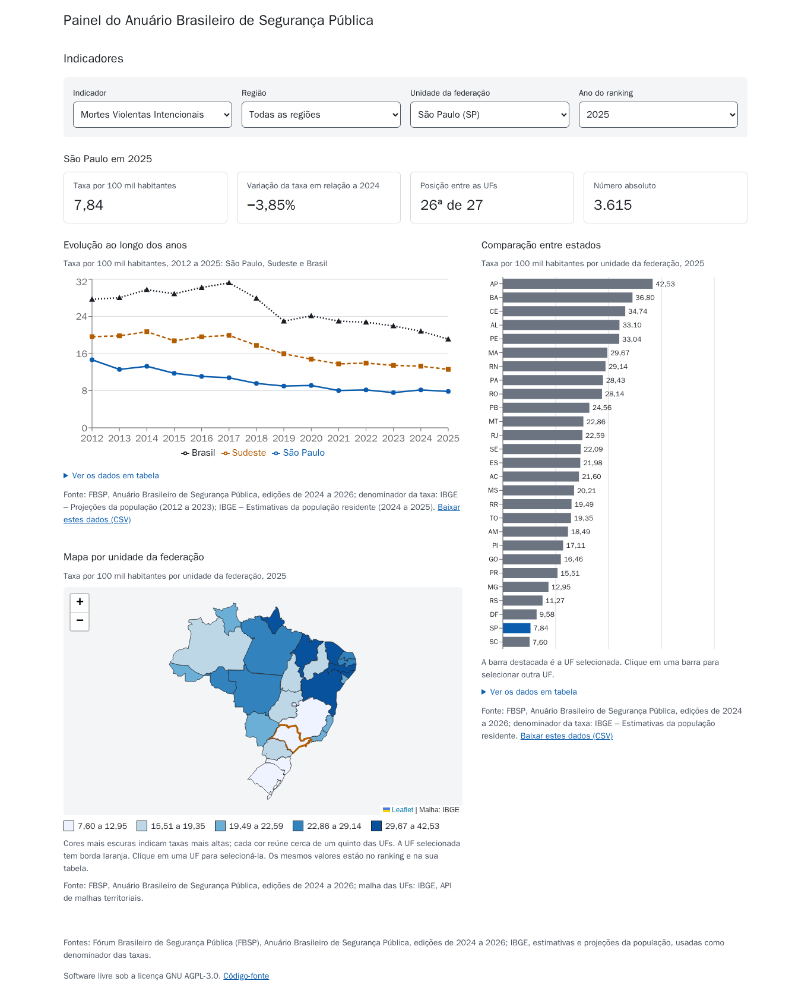
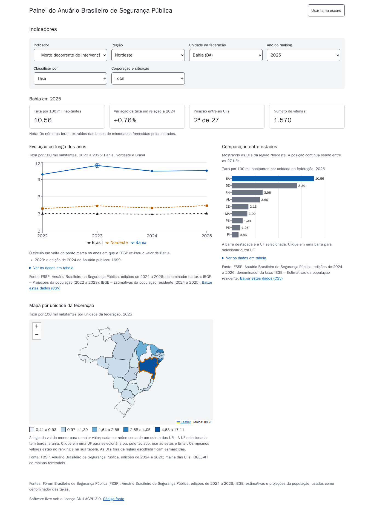

# Painel do Anuário Brasileiro de Segurança Pública

Plataforma web que organiza em banco de dados, disponibiliza por uma API REST aberta e mostra num
painel interativo e acessível os principais indicadores do Anuário Brasileiro de Segurança Pública,
do Fórum Brasileiro de Segurança Pública (FBSP), com taxas calculadas a partir da população do IBGE.

Projeto Integrador II. Versão atual: **1.4.0**.



## O que tem aqui

- **Dados:** Mortes Violentas Intencionais (MVI) e seus componentes (homicídio doloso, latrocínio,
  lesão corporal seguida de morte e morte decorrente de intervenção policial), feminicídio e
  homicídio de mulheres, roubo (total e sete subtipos) e furto de veículos e de celulares, para as
  27 UFs, as cinco regiões e o Brasil. MVI de 2012 a 2025; os demais, de 2022 a 2025. As mortes por
  intervenção policial também por corporação e situação do policial.
- **Painel:** filtros por indicador, região, UF e ano; cartões com taxa, variação e posição da UF;
  evolução da UF, da região e do Brasil; ranking e mapa das UFs; tabelas e download em CSV; tema
  claro e escuro; link compartilhável.
- **API:** consultas por UF, região, ano, indicador, subtipo, unidade (vítimas ou ocorrências) e
  recorte, com ranking, comparação, metadados, CSV e documentação interativa.

## Começar em 5 minutos

Requisito: Docker com o plugin Compose.

```bash
git clone https://github.com/yocaslu/projeto-integrador-ii.git
cd projeto-integrador-ii
cp .env.example .env
docker compose up -d --build
docker compose exec backend uv run python manage.py migrate
docker compose exec backend uv run python manage.py importar_anuario
```

Depois abra:

| | Endereço |
| --- | --- |
| Painel | <http://localhost:5173> |
| API | <http://localhost:8000/api/v1/> |
| Documentação interativa da API | <http://localhost:8000/api/v1/docs/> |

A importação leva alguns segundos e termina com
`Carga … concluída: 3498 registros (460 regionais calculados) e 462 populações.`

## Usar o painel

Escolha o indicador, a região, a UF e o ano no topo da página. Os cartões mostram a UF; o gráfico
de evolução a compara com a sua região e com o Brasil; o ranking e o mapa comparam as 27 UFs pelo
critério escolhido (taxa, número absoluto ou participação). Clique numa barra ou numa UF do mapa
para selecioná-la. Cada bloco tem a tabela com os números e um link para baixar em CSV, e o
endereço da página guarda os filtros para compartilhar.



Guia completo: **[docs/guia-do-painel.md](docs/guia-do-painel.md)**.

## Usar a API

```bash
# MVI da Bahia em 2025: valor, taxa, variação, situação do dado e fontes
curl 'http://localhost:8000/api/v1/registros/?uf=BA&ano=2025&indicador=mvi'

# Ranking das UFs pela taxa de feminicídio no último ano
curl 'http://localhost:8000/api/v1/ranking/?indicador=feminicidio'

# Bahia × Nordeste × Brasil ao longo dos anos
curl 'http://localhost:8000/api/v1/comparacao/?uf=BA&indicador=mvi'

# Roubo e todos os subtipos, em CSV
curl -o roubo.csv 'http://localhost:8000/api/v1/registros/?indicador=roubo&incluir_subtipos=true&formato=csv'
```

```python
import pandas as pd
df = pd.read_csv("http://localhost:8000/api/v1/registros/?nivel=pais,regiao,uf&indicador=mvi&formato=csv")
```

A API é somente leitura, não pede autenticação, responde em JSON ou CSV e explica os erros.
Receitas, campos, filtros, CSV no Excel e códigos de erro: **[docs/guia-da-api.md](docs/guia-da-api.md)**.

## Documentação

| Para | Leia |
| --- | --- |
| Usar o painel | [docs/guia-do-painel.md](docs/guia-do-painel.md) |
| Consultar os dados pela API | [docs/guia-da-api.md](docs/guia-da-api.md) |
| Instalar, importar dados, publicar em produção e resolver problemas | [docs/operacao.md](docs/operacao.md) |
| Testar, contribuir e publicar versões | [docs/desenvolvimento.md](docs/desenvolvimento.md) |
| Entender como foi construído | [docs/README.md](docs/README.md) (arquitetura, contrato da API, importação, modelagem e decisões) |

## Fontes dos dados

- Fórum Brasileiro de Segurança Pública (FBSP), Anuário Brasileiro de Segurança Pública, edições de
  2024, 2025 e 2026.
- Instituto Brasileiro de Geografia e Estatística (IBGE): projeções da população (2012 a 2023 e
  população feminina), estimativas da população residente (2024 e 2025) e malha das UFs.
- Secretaria Nacional de Trânsito (Senatran), frota de veículos, e Banco Central do Brasil,
  instituições financeiras, como denominadores de taxas publicadas pelo FBSP.

Os arquivos originais, com a origem e o SHA-256 de cada um, estão em [`dados/`](dados/README.md).

## Licença

Software livre, distribuído sob a [GNU Affero General Public License v3.0](LICENSE).
