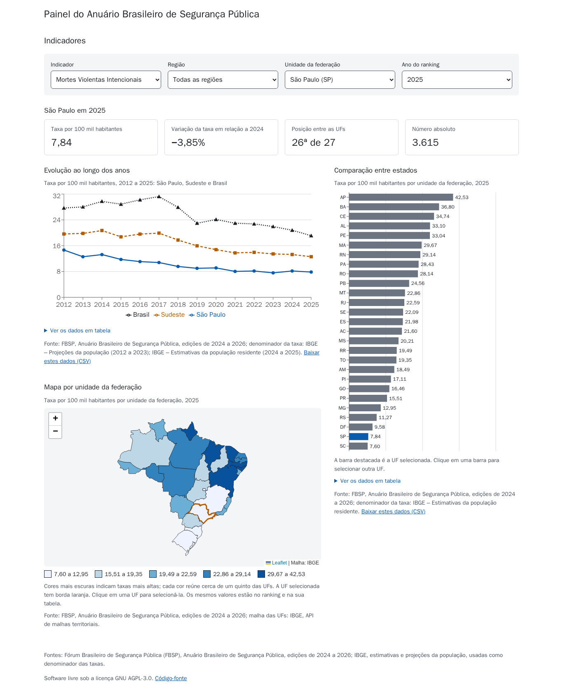
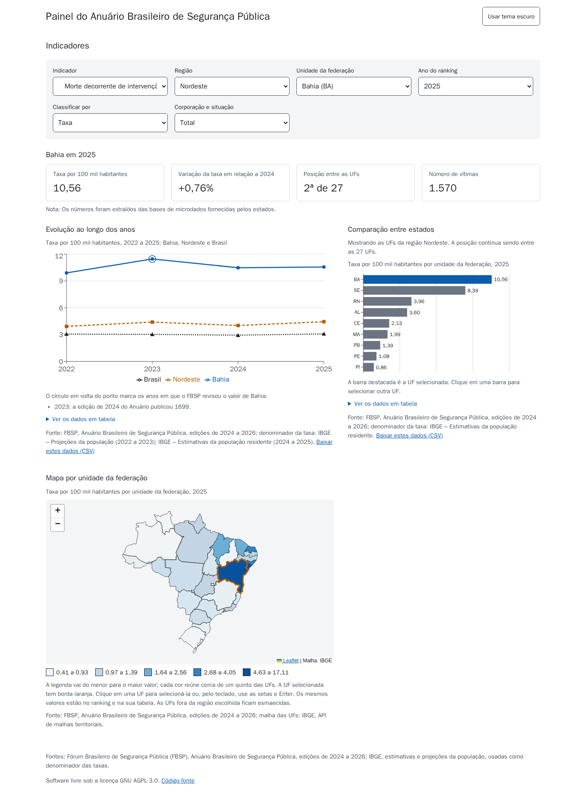
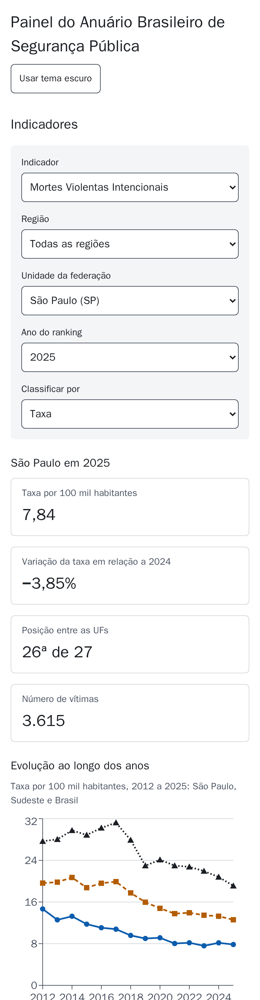

# Painel do Anuário Brasileiro de Segurança Pública

Plataforma web de análise de dados que estrutura em banco relacional, disponibiliza por meio de
uma API REST própria e visualiza de forma interativa e acessível os principais indicadores do
Anuário Brasileiro de Segurança Pública, do Fórum Brasileiro de Segurança Pública (FBSP), com taxas
por habitante calculadas a partir da população do IBGE.

Projeto Integrador II.



## Situação

| Parte | Estado |
| --- | --- |
| Banco de dados e importação das planilhas | Pronto: 3.498 registros e 462 populações, sem divergência acima de 1e-6 no relatório de validação |
| API REST v1 (`/api/v1/`) | Pronta: todos os recursos do contrato, com CSV, cache e documentação OpenAPI |
| Dashboard (React) e testes de ponta a ponta | Pronto: filtros, cartões, evolução, ranking, mapa e CSV, com testes de acessibilidade |

Indicadores: Mortes Violentas Intencionais (MVI) e seus componentes, letalidade policial (por
corporação e situação do policial), feminicídio, roubo (total e subtipos) e furto (veículos e
celulares; o Anuário não publica total de furtos), de 2022 a 2025 para as 27 UFs, as cinco regiões
e o Brasil, e a série histórica de MVI desde 2012. Os dados vêm das edições de 2024 a 2026 do Anuário.

## Interface

O painel é uma única página, que consome só a API:

- **Filtros:** indicador, região, UF, ano e critério do ranking (taxa, número absoluto ou participação), além de unidade e de corporação e situação do policial nos indicadores que as têm. A seleção fica na URL, então o link pode ser compartilhado.
- **Cartões da UF:** taxa, variação em relação ao ano anterior, posição entre as UFs e número absoluto, com a situação do dado e as notas.
- **Evolução:** linhas da UF, da sua região e do Brasil, com todos os anos do indicador e os anos revisados pelo FBSP marcados. Com recorte, mostra só a UF ([ADR 0009](docs/adr/0009-variacao-do-brasil-em-recortes.md)).
- **Comparação entre estados:** barras ordenadas pelo critério escolhido. Clicar em uma barra seleciona a UF.
- **Mapa:** UFs coloridas em cinco faixas do mesmo critério. Selecione com um clique ou, pelo teclado, com as setas e Enter.
- **Dados abertos:** tabelas com os números de cada gráfico, links para baixar em CSV e fontes indicadas em cada bloco.

Com uma região escolhida, o ranking mostra só as UFs dela, com a posição entre as 27, e o mapa esmaece as demais:



A página se adapta a telas estreitas:



## Ambiente de desenvolvimento

Requisitos: Docker com o plugin Compose.

```bash
cp .env.example .env
docker compose up -d --build
docker compose exec backend uv run python manage.py migrate
docker compose exec backend uv run python manage.py importar_anuario
```

| Serviço | Endereço |
| --- | --- |
| Painel | <http://localhost:5173> |
| API | <http://localhost:8000/api/v1/> |
| Documentação interativa (Swagger UI) | <http://localhost:8000/api/v1/docs/> |
| Documentação (ReDoc) | <http://localhost:8000/api/v1/redoc/> |
| Esquema OpenAPI 3 | <http://localhost:8000/api/v1/schema/> |

O banco e a API só aceitam conexões do próprio computador; o painel, que repassa as chamadas à API,
fica acessível na rede local. Antes de importar, a API responde 503 em todos os recursos de dados, e o painel mostra o erro.

### Importação dos dados

`importar_anuario` lê as planilhas do FBSP e a população do IBGE de `dados/brutos/`, confere o
SHA-256 de cada arquivo contra `dados/README.md`, grava tudo numa transação e gera o relatório de
validação em `dados/relatorios/` (CSV e Markdown). Rodar de novo não duplica nada nem muda os `id`s.

Cada ano vem da edição mais recente do Anuário que o traz: 2024 e 2025 da edição de 2026, 2023 da de
2025 e 2022 da de 2024. A série de MVI vem só da edição de 2026. Quando uma edição revisa um valor, o
número anterior fica na `observacao` do registro ([ADR 0012](docs/adr/0012-edicoes-anteriores-do-anuario.md)).

| Opção | Efeito |
| --- | --- |
| `--somente-validar` | Lê, confere e gera o relatório sem gravar nada no banco. |
| `--estrito` | Termina com erro se o relatório tiver alguma divergência. |
| `--dados`, `--relatorio`, `--manifesto` | Outros diretórios de entrada e saída e outro arquivo de hashes. |

Numa nova edição da planilha, `python manage.py inspecionar_planilha [ABA ...]` mostra âncoras e
caminhos de cabeçalho de cada tabela antes de alguém ajustar o mapeamento. A especificação completa
está em [`docs/importacao.md`](docs/importacao.md).

## API

API REST somente leitura (`GET`, `HEAD`, `OPTIONS`), com nomes em português.

| Recurso | Conteúdo |
| --- | --- |
| `/regioes/`, `/estados/` | Brasil, cinco regiões e 27 UFs, com os códigos do IBGE |
| `/indicadores/`, `/recortes/`, `/fontes/` | Catálogo de indicadores (em hierarquia), recortes e fontes |
| `/registros/` | Valores, taxas, variação em relação ao ano anterior, participação, situação do dado e notas, com filtros por nível, UF, região, indicador, ano, unidade, recorte e situação |
| `/populacao/` | População do IBGE usada nas taxas, de 2012 a 2025 |
| `/ranking/` | UFs ordenadas por taxa, valor ou participação, com empates |
| `/comparacao/` | Série de uma UF ao lado da sua região e do Brasil |
| `/metadados/` | Tudo o que um painel precisa para montar filtros e legendas numa requisição |

```bash
curl 'http://localhost:8000/api/v1/registros/?uf=BA&ano=2025&indicador=mvi'
curl 'http://localhost:8000/api/v1/ranking/?indicador=morte-intervencao-policial&criterio=participacao'
curl 'http://localhost:8000/api/v1/registros/?indicador=roubo&incluir_subtipos=true&formato=csv'
```

- **Sem dupla contagem por padrão:** `/registros/` devolve só totais, na unidade padrão de cada
  indicador e só as UFs; recortes, outras unidades e outros níveis vêm só quando pedidos.
- **Decimais em texto** (`"40.94"`), para preservar a precisão do `numeric`.
- **CSV** em `/registros/`, `/populacao/`, `/ranking/` e `/comparacao/`, com `formato=csv` ou
  `Accept: text/csv`.
- **Erros** em Problem Details (RFC 9457), sempre em JSON.
- **Cache:** `Cache-Control: public, max-age=86400` e `ETag` pela versão da carga; reenviar o ETag
  em `If-None-Match` devolve 304.

O contrato completo, com cada parâmetro, regra de validação, formato e coluna de CSV, está em
[`docs/contrato-api.md`](docs/contrato-api.md). Mudança incompatível dá origem a `/api/v2/`.

## Testes e qualidade

Com o ambiente no ar:

```bash
docker compose exec backend uv run ruff check . && docker compose exec backend uv run ruff format --check .
docker compose exec backend uv run pytest                              # cobertura mínima de 75%
docker compose exec backend uv run pytest -m planilha_real --no-cov    # importa a planilha completa
docker compose exec backend uv run pytest -m desempenho --no-cov       # RNF02: p95 < 500 ms
docker compose exec frontend npx jest --ci                             # testes do painel
(cd e2e && npm ci && npx playwright install chromium && npx playwright test)   # ponta a ponta e axe-core
```

Os testes de ponta a ponta precisam dos dados importados.

O CI (GitHub Actions) roda, no backend, o Ruff, a checagem de migrações pendentes, os testes com
cobertura, a importação da planilha real, a comparação do `docs/api/openapi.yaml` com o esquema
gerado e o teste de desempenho. Os testes do frontend e de ponta a ponta rodam em todo push na `main`,
em todo release e nos pull requests que mudam `frontend/` ou `e2e/`.

## Estrutura

| Diretório | Conteúdo |
| --- | --- |
| `.github/` | Pipelines do GitHub Actions (CI e implantação) e modelo de pull request. |
| `backend/` | API em Django e Django REST Framework, gerenciada com uv; apps `localidades`, `catalogo`, `registros`, `importacao` e `api`. |
| `frontend/` | Painel em React, com Recharts e Leaflet. |
| `e2e/` | Testes de ponta a ponta e de acessibilidade com Playwright e axe-core. |
| `dados/` | Planilhas oficiais do FBSP e do IBGE, com o SHA-256 de cada uma, e relatórios de validação. |
| `infra/` | Compose de produção, Traefik e scripts de implantação. |
| `docs/` | Arquitetura, contrato da API, importação, modelagem, esquema OpenAPI, decisões (ADR) e capturas da interface. |

O índice da documentação está em [`docs/README.md`](docs/README.md).

## Convenções

- Commits no padrão [Conventional Commits](https://www.conventionalcommits.org/pt-br/), em
  português, com o escopo da app: `feat(api): adiciona endpoint de ranking`, `fix(importacao): ...`.
- Uma branch por tarefa, integrada à `main` por pull request com o CI aprovado e a Definição de
  pronto cumprida (checklist no modelo de pull request).
- Nenhuma credencial no repositório: tudo vem de variáveis de ambiente (veja `.env.example`).
- As regras do projeto (decisões, regras invariáveis e Definição de pronto) estão em
  [`CLAUDE.md`](CLAUDE.md); decisões de arquitetura, em [`docs/adr/`](docs/adr/).

## Versões

As versões seguem o [SemVer](https://semver.org/lang/pt-BR/) e são publicadas como
[releases](https://github.com/yocaslu/Projeto-Integrador-II/releases), com imagens Docker no GitHub
Container Registry: `ghcr.io/yocaslu/projeto-integrador-ii/backend` e `.../frontend`. A versão da
aplicação é independente da versão da API (`/api/v1/`), que só muda com quebra de contrato.

Para publicar uma versão:

1. Em um pull request, suba a versão nos quatro arquivos:

   ```bash
   (cd frontend && npm version X.Y.Z --no-git-tag-version)
   sed -i 's/^version = ".*"/version = "X.Y.Z"/' backend/pyproject.toml
   (cd backend && uv lock)
   ```

2. Depois do merge, crie a tag na `main`:

   ```bash
   git switch main && git pull
   git tag -a vX.Y.Z -m "vX.Y.Z"
   git push origin vX.Y.Z
   ```

O workflow `release.yml` confere a tag, roda o CI completo, publica as imagens (`X.Y.Z`, `X.Y` e
`latest`) e cria o release. Ele não implanta: para usar uma versão, defina `TAG=X.Y.Z` no
`infra/compose.prod.yml`. Detalhes no [ADR 0010](docs/adr/0010-versionamento-e-releases.md).

## Fontes dos dados

- Fórum Brasileiro de Segurança Pública (FBSP), Anuário Brasileiro de Segurança Pública, edições de
  2024, 2025 e 2026.
- Instituto Brasileiro de Geografia e Estatística (IBGE), projeções da população (2012 a 2023 e taxas
  por 100 mil mulheres), estimativas da população residente (2024 e 2025) e malha das UFs.
- Secretaria Nacional de Trânsito (Senatran), frota de veículos, e Banco Central do Brasil,
  instituições financeiras, como denominadores de taxas publicadas pelo FBSP.

## Licença

Distribuído sob a [GNU Affero General Public License v3.0](LICENSE).
