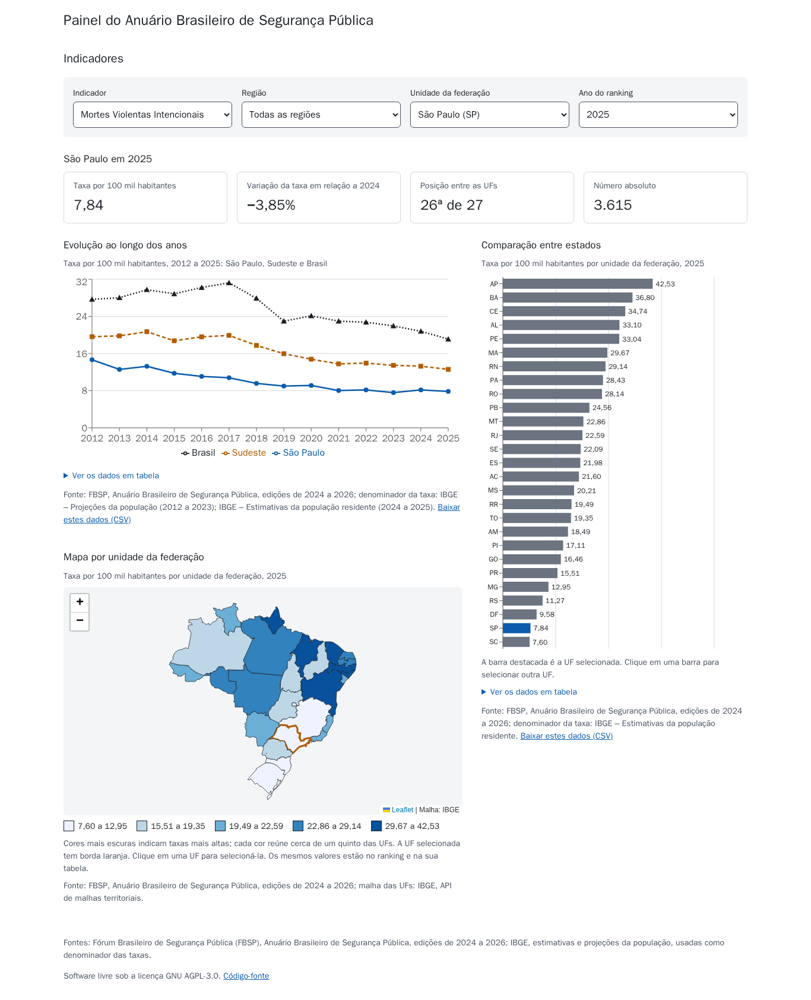
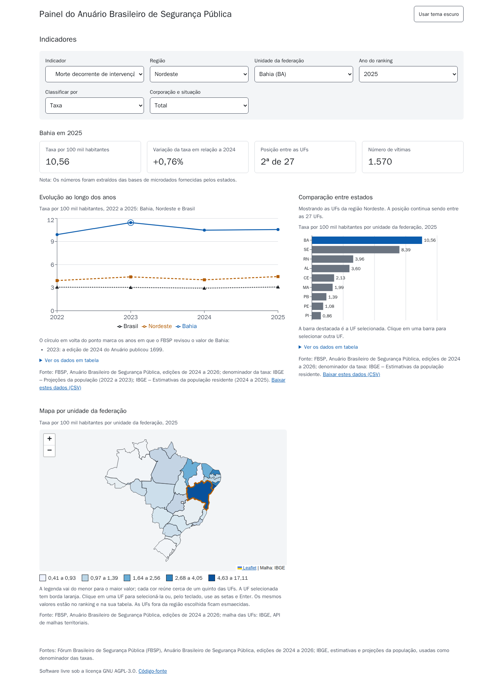
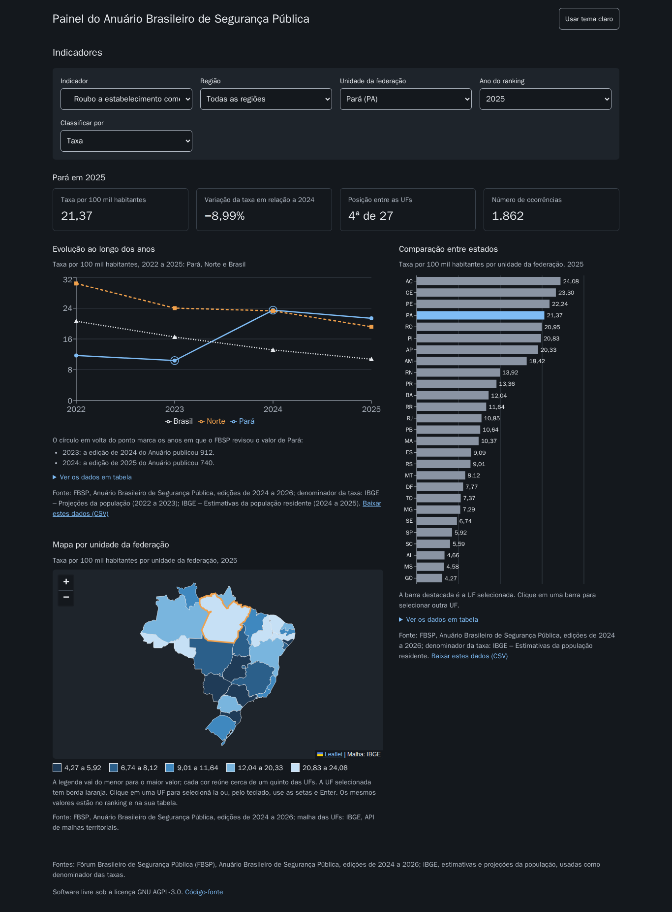

# Guia do painel

O painel é uma única página que mostra os indicadores do Anuário Brasileiro de Segurança Pública
por unidade da federação (UF). Ele só lê a API: tudo o que aparece nele também pode ser consultado
ou baixado pela API ([guia-da-api.md](guia-da-api.md)).

Endereço local: <http://localhost:5173> (veja [operacao.md](operacao.md) para subir o ambiente).

## 1. Escolher o que ver

Os filtros ficam no topo da página. Ao abrir o painel sem nenhum filtro, ele mostra as Mortes
Violentas Intencionais (MVI) de São Paulo no último ano disponível, comparadas pela taxa.

| Filtro | O que faz | Observações |
| --- | --- | --- |
| **Indicador** | Escolhe o crime. A lista é recuada para mostrar a hierarquia: homicídio doloso, latrocínio, lesão corporal seguida de morte e morte por intervenção policial ficam dentro de MVI; os tipos de roubo dentro de Roubo; furto de veículo e de celular dentro de Furto. | "Furto" aparece desabilitado: o Anuário não publica um total de furtos, só os dois subtipos. Trocar de indicador volta ano, unidade e recorte ao padrão. |
| **Região** | Restringe a lista de UFs e o ranking às UFs da região; o mapa esmaece as demais. | Escolher uma região que não contém a UF atual seleciona a primeira UF dela. |
| **UF** | Define a UF dos cartões e da linha principal do gráfico de evolução, e a destaca no ranking e no mapa. | Também é possível trocar a UF clicando no ranking ou no mapa. |
| **Ano** | Ano dos cartões, do ranking e do mapa. | MVI tem anos de 2012 a 2025; os demais indicadores, de 2022 a 2025. O gráfico de evolução mostra sempre todos os anos. |
| **Comparar por** | Critério do ranking e do mapa: **Taxa** (padrão), **Número absoluto** ou **Participação**. | A taxa é o padrão porque o número absoluto só reflete o tamanho da população. "Participação" só aparece em subtipos (ex.: quanto da MVI é morte por intervenção policial) e em recortes. |
| **Unidade** | Vítimas ou ocorrências. | Só aparece em homicídio doloso, latrocínio e lesão corporal seguida de morte, os únicos com as duas contagens. |
| **Corporação e situação** | Recorte por Polícia Civil ou Militar, em serviço ou fora de serviço. | Só aparece em "Morte decorrente de intervenção policial". |

## 2. Ler os resultados

### Cartões da UF

Quatro números da UF escolhida no ano escolhido:

- **Taxa** na base do indicador (por 100 mil habitantes na maioria; por 100 mil mulheres em
  feminicídio e homicídio de mulheres; por 100 mil veículos em roubo e furto de veículos; por 100
  instituições em roubo a instituição financeira).
- **Variação da taxa** em relação ao ano anterior, a mesma coluna "Variação (%)" das tabelas do
  Anuário.
- **Posição entre as 27 UFs** pelo critério escolhido (1 = maior valor). Empates recebem a mesma
  posição.
- **Número absoluto** de vítimas ou de ocorrências.

Quando o dado não existe, o cartão diz por quê: **fenômeno inexistente** (o Anuário publica "-",
que vale zero) ou **informação não disponível** (o Anuário publica "...", e não há valor). As notas
metodológicas do FBSP para aquele dado aparecem logo abaixo.

### Evolução ao longo dos anos

Três linhas: a UF, a sua região e o Brasil, por taxa, em todos os anos do indicador. As linhas
diferem pela cor, pelo traço e pelo marcador, de modo que a leitura não depende só da cor.

Um círculo em volta de um ponto da UF indica que o FBSP **revisou** aquele número numa edição mais
nova do Anuário; a lista abaixo do gráfico mostra o valor publicado antes. Com um recorte de
corporação ou situação, o gráfico mostra só a UF: o Brasil desses recortes é uma soma apenas das
UFs que informaram, e não é comparável de um ano para outro.

### Comparação entre estados (ranking)

Barras das UFs, da maior para a menor, pelo critério escolhido. A UF selecionada fica destacada.
Clicar numa barra seleciona aquela UF. Com uma região escolhida, aparecem só as UFs dela, mas a
posição continua sendo a posição entre as 27.

### Mapa por UF

As UFs são pintadas em cinco faixas do critério escolhido; a legenda mostra os limites de cada
faixa. UFs sem dado ficam em cinza. Para selecionar uma UF:

- com o mouse ou o dedo: clique na UF;
- pelo teclado: leve o foco ao mapa com Tab, percorra as UFs com as setas e confirme com Enter.

## 3. Levar os dados para fora

- **Ver os números:** abaixo de cada gráfico, "Ver os dados em tabela" abre uma tabela com os
  mesmos números, legível por leitores de tela.
- **Baixar em CSV:** cada bloco tem o link "Baixar estes dados (CSV)", que chama a API com os
  filtros atuais. O arquivo usa vírgula como separador e ponto como separador decimal; veja como
  abrir no Excel ou no LibreOffice em [guia-da-api.md](guia-da-api.md#5-exportar-em-csv).
- **Compartilhar a visão:** os filtros ficam no endereço da página, por exemplo
  `http://localhost:5173/?indicador=feminicidio&uf=BA&criterio=valor`. Quem abrir o link vê a
  mesma seleção. O ano mais recente não entra no link, para que ele continue mostrando o último ano
  quando houver uma edição nova. Valores inválidos no endereço voltam ao padrão.

## 4. Acessibilidade e aparência

- **Tema claro e escuro:** o botão no cabeçalho alterna o tema. Sem escolha, o painel segue o tema
  do sistema operacional; a escolha fica salva no navegador.
- **Teclado:** todos os filtros, o mapa, o ranking e as tabelas funcionam sem mouse; o foco é
  visível.
- **Cores:** a paleta foi escolhida para continuar distinguível nos tipos mais comuns de daltonismo,
  e o contraste foi verificado automaticamente (axe-core, WCAG 2.1 AA) nos dois temas.
- **Celular:** em telas estreitas, os blocos ficam em uma coluna.

## 5. Cuidados na leitura

- **Não some subtipos.** Os subtipos de roubo não fecham o total (uma ocorrência pode entrar em mais
  de um) e não existe total de furtos. A participação de um subtipo também não deve ser somada.
- **Compare taxas, não números absolutos,** quando comparar UFs de tamanhos diferentes.
- **Regiões fora da MVI são calculadas pelo projeto** como soma das UFs (o Anuário só publica
  regiões na série de MVI). Se alguma UF da região não informou o dado, a região fica sem valor, em
  vez de mostrar uma soma parcial.
- **Denominadores das taxas:** a população vem do IBGE (projeções de 2012 a 2023 e estimativas de
  2024 e 2025), as mesmas usadas pelo FBSP. As taxas por mulheres, veículos e instituições são as
  publicadas pelo Anuário.

## 6. Quando algo não aparece

| Sintoma | Causa provável |
| --- | --- |
| "Não foi possível carregar os dados" no lugar dos blocos | A API ainda não tem dados importados (responde 503). Rode a importação ([operacao.md](operacao.md#3-importar-os-dados)). |
| "Não foi possível exibir o mapa: malha das UFs não encontrada" | Falta o arquivo da malha das UFs, `frontend/public/malhas/ufs.json` ([frontend/public/README.md](../frontend/public/README.md)). |
| Um ano não aparece na lista | O indicador não tem dados naquele ano. |
| Cartão sem valor | O FBSP marcou o dado como "informação não disponível" para aquela UF e ano. |
